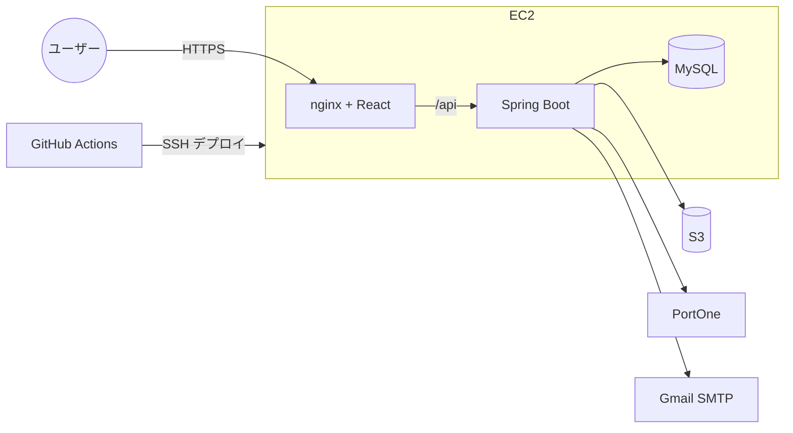

# Prep2gether

      

[한국어](README.md) · **日本語**

就職活動中の学生のためのコミュニティプラットフォームです。掲示板、スタディ、専門家との 1 対 1 相談を一つのサービスで利用できます。

**[サービスを開く](https://prep2gether-sunwoo.duckdns.org)** · [発表資料 (PDF)](docs/presentation.pdf)

- LIKELION（멋쟁이사자처럼）バックエンド 24 期の第 1 次チームプロジェクト、Team 일석이조（バックエンド 4 名）
- 期間：2026.07.29 ～ 08.27（4 週間）
- チームのリポジトリ（`likelion-backend-24th/ProjectTeam_2`）を引き継ぎ、プロジェクト終了後に個人の GitHub・AWS へ移して運用しています。

## 作った理由

チームで決めた大きなテーマはコミュニティでした。どんなコミュニティを作るか話し合う中で、私は今の 20 代にとって一番の悩みである就職をテーマにしようと提案しました。情報があふれている今は、何を選んでどの方向に準備すればいいのか、かえって迷ってしまうことを自分自身が経験していたからです。そこで、就活生同士が交流できるコミュニティに、信頼できる専門家に方向性を相談できる機能を加えようと提案しました。

情報やスタディの募集が複数のプラットフォームに散らばっていること、専門家への相談は高額で信頼できる相手を探しにくいことも、チームのメンバーと一緒に整理しました。その結果、掲示板からスタディ、専門家相談へとつながる流れを作り、相談だけを月額サブスクリプションに分けました。

```text
会員登録（メール認証）→ ログイン → 掲示板 · スタディ
                                   └→ サブスク決済（PortOne）→ 専門家との 1 対 1 相談
```

## チーム構成と役割

一つのドメインを一人がバックエンドから画面まで担当する形で分担しました。

| 担当 | ドメイン | 主な機能 |
|---|---|---|
| 최승환 | USER | 会員登録・メール認証・JWT、ソーシャルログイン（Kakao・Google・Naver）、マイページ、管理者 |
| 김태영 | POST | 掲示板の検索・ページング、コメント、通報の共通モジュール |
| 김지선 | STUDY | スタディの募集・参加・管理、スタディ掲示板、画像アップロード（S3） |
| **정선우** | **EXPERT** | 専門家の登録・審査、1 対 1 相談スレッド、有料サブスクリプション・定期決済（PortOne） |

定期決済はチームで一番難しい部分だったため、4 人がそれぞれ一度実装してみてから一つを選び、統合しました。私は開発のほかに、サービスのテーマを提案する企画の役割も担いました。

## 私が作ったもの：専門家相談

**専門家の登録と審査**
専門家が経歴・資格・自己紹介を入力して申請すると、管理者が承認または却下し、結果をメールで知らせます。承認後に資格がはく奪されると、その専門家の進行中の相談も終了します。

**1 対 1 相談スレッド**
サブスク会員が承認済みの専門家に相談を申し込むと、カカオトークや LINE のように二人でメッセージをやり取りできるチャット画面が開きます。このプロジェクトで一番印象に残っている機能です。メッセージには画像を添付でき、専門家が回答した後に依頼者が再度質問すると「回答待ち」の状態に戻ります。同じ専門家との相談は重複して開けず、同時に進められる相談は 5 件までに制限しました。問題のある相談は通報でき、管理者は通報された相談だけを閲覧できます。

**サブスクリプション**
サブスクの申し込み・解約・照会と、期限が過ぎると自動で終了するスケジューラーを作りました。退会または停止された会員は相談とサブスクが利用できず、退会時には進行中の相談が自動で終了します。

## トラブルシューティング（担当ドメイン）

| 問題 | 原因と解決 |
|---|---|
| 相談メッセージがすぐに送信されず、1～3 秒遅れて反映される | 専門家が回答すると依頼者に通知メールを送るが、このメール送信がメッセージの保存と同じ処理の中で終わるまで待っていた。メッセージの保存が終わった後、メールは別に（非同期で）送るよう変更して遅延をなくし、メール送信が失敗しても保存したメッセージが取り消されないようにした |

## 技術スタック

| 領域 | 使用技術 |
|---|---|
| Backend | Java 21, Spring Boot 3.5, Spring Data JPA, Spring Security, JWT, OAuth2 |
| Frontend | React 19, Vite, Axios |
| Data | MySQL 8.0 |
| 外部連携 | PortOne V2（決済）, AWS S3（画像）, Gmail SMTP（メール） |
| Infra | Docker Compose, nginx, AWS EC2, GHCR, GitHub Actions, Let's Encrypt |
| Test | JUnit5, H2 |

## 構成図



## チームプロジェクトの後

発表時に「今後の予定」として残っていた HTTPS の適用を仕上げるため、プロジェクト終了後にリポジトリを個人の GitHub・AWS に移しました。

- HTTPS の適用（Let's Encrypt）、DuckDNS のドメイン接続
- CI が通ったらイメージをビルドして EC2 に自動デプロイ
- ソーシャルログインと PortOne の決済チャネルを新しいドメインで再連携
- 初回デプロイ時に t3.micro の CPU クレジットが尽きて SSH まで使えなくなったため、t3.small に変更

デプロイ中に起きた問題は[デプロイのトラブルシューティング](docs/deployment-troubleshooting.md)にまとめています（韓国語）。

**セキュリティの点検**
移行後にコードを見直し、三つの問題を見つけました。

- 決済連携以前に使っていた `POST /api/subscriptions` が残っており、ログインさえすれば決済なしでサブスクに登録できました。このエンドポイントを削除しました。
- PortOne の Webhook シークレットが CI の設定ファイルに実際の値のまま入っていました。シークレットを再発行し、ダミー値に置き換えました。このときダミー値の形式が合わずテストが壊れていましたが、CI が設定ファイルの変更では実行されないため、しばらく気づきませんでした。形式を合わせ、設定ファイルが変わったときも CI が動くように修正しました。
- Kakao の REST API キーがフロントエンドのビルドにそのまま含まれていました。キーは再発行しましたが、トークン交換をバックエンドに移す根本的な修正はまだできていません。

## AI の活用

チーム期間中は、フロントエンドのページを作るときだけ AI を使い、担当のバックエンドドメインは自分で開発しました。チームプロジェクト後の個人デプロイ、セキュリティの点検、ドキュメントの整理は Claude と一緒に進めました。

## 課題と今後の予定

- Kakao のトークン交換をバックエンドに移し、キーがフロントエンドに露出しないようにする必要があります。
- デプロイが SSH 方式のため 22 番ポートが開いており、証明書の自動更新もまだ設定していません。
- 現在の CD は、フロントエンドの CI が通るだけでバックエンドまでデプロイされます。バックエンドのテストが失敗したらデプロイされないように変える必要があります。
- メール送信が失敗しても、それに気づく手段がありません。

## ローカルでの実行

JDK 21、Node.js 20 以上、Docker が必要です。

```bash
git clone https://github.com/DANIELSUNWOO/prep2gether.git
cd prep2gether
# backend/.env, frontend/.env を作成（frontend/.env.example を参照）
docker compose up -d --build
```

- フロントエンド: http://localhost
- Swagger: http://localhost:8080/swagger-ui/index.html

要件定義、機能仕様、API 仕様、ERD、権限マトリクスは [docs](docs/) フォルダにあります（韓国語）。
