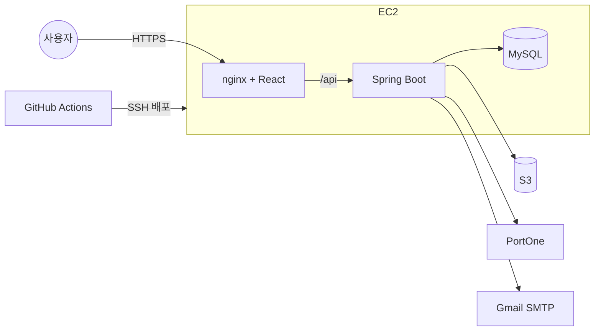

# Prep2gether

      

**한국어** · [日本語](README.ja.md)

취업 준비생을 위한 커뮤니티 플랫폼입니다. 게시판, 스터디, 전문가 1:1 상담을 한 서비스에서 이용할 수 있습니다.

**[서비스 바로가기](https://prep2gether-sunwoo.duckdns.org)** · [발표 자료 (PDF)](docs/presentation.pdf)

- 멋쟁이사자처럼 백엔드 24기 1차 팀 프로젝트, Team 일석이조 (백엔드 4명)
- 기간: 2026.07.29 ~ 08.27 (4주)
- 팀 저장소(`likelion-backend-24th/ProjectTeam_2`)를 가져와, 프로젝트 종료 후 개인 GitHub·AWS로 옮겨 운영하고 있습니다.

## 만든 이유

팀에서 정한 큰 주제는 커뮤니티였고, 어떤 커뮤니티를 만들지 고민하다가 저는 지금 20대의 가장 큰 고민인 취업을 제안했습니다. 정보가 너무 많은 지금은 무엇을 골라 어떤 방향으로 준비해야 할지 오히려 혼란스럽다는 것을 저 스스로 겪고 있었기 때문입니다. 그래서 취업 준비생끼리 소통하는 커뮤니티에, 검증된 전문가에게 방향을 물어볼 수 있는 상담 기능을 더하자고 제안했습니다.

정보와 스터디 모집이 여러 플랫폼에 흩어져 있다는 점, 전문가 상담은 비싸고 믿을 만한 곳을 찾기 어렵다는 점도 팀원들과 함께 정리했습니다. 그 결과 게시판에서 시작해 스터디, 전문가 상담으로 이어지는 흐름을 만들고, 상담만 월 구독으로 분리했습니다.

```text
회원가입(이메일 인증) → 로그인 → 게시판 · 스터디
                                   └→ 구독 결제(PortOne) → 전문가 1:1 상담
```

## 팀 구성과 역할

도메인 하나를 한 사람이 백엔드부터 화면까지 맡는 방식으로 나눴습니다.

| 담당 | 도메인 | 주요 기능 |
|---|---|---|
| 최승환 | USER | 회원가입·이메일 인증·JWT, 소셜 로그인(카카오·구글·네이버), 마이페이지, 관리자 |
| 김태영 | POST | 게시판 검색·페이징, 댓글, 신고 공통 모듈 |
| 김지선 | STUDY | 스터디 모집·가입·관리, 스터디 게시판, 이미지 업로드(S3) |
| **정선우** | **EXPERT** | 전문가 등록·심사, 1:1 상담 스레드, 유료 구독·정기결제(PortOne) |

정기결제는 팀에서 가장 어려운 부분이라 네 명이 각자 한 번씩 구현해 본 뒤 하나를 골라 합쳤습니다. 저는 개발 외에 서비스 주제를 제안하는 기획 역할도 맡았습니다.

## 내가 만든 것: 전문가 상담

**전문가 등록과 심사**
전문가가 경력·자격증·소개글을 입력해 신청하면 관리자가 승인하거나 반려하고, 결과를 메일로 알립니다. 승인 후 자격이 박탈되면 그 전문가의 진행 중 상담도 함께 종료됩니다.

**1:1 상담 스레드**
구독자가 승인된 전문가에게 상담을 요청하면, 카카오톡이나 라인처럼 둘이 메시지를 주고받는 대화창이 열립니다. 이 프로젝트에서 가장 기억에 남는 기능입니다. 메시지에 이미지를 첨부할 수 있고, 전문가가 답변한 뒤 요청자가 다시 질문하면 "답변 대기" 상태로 돌아갑니다. 같은 전문가에게 중복 상담은 열 수 없고, 동시에 진행할 수 있는 상담은 5개로 제한했습니다. 문제가 있는 상담은 신고할 수 있고, 관리자는 신고된 상담만 열람할 수 있습니다.

**구독**
구독 신청·해지·조회와 만료일이 지나면 자동으로 끝나는 스케줄러를 만들었습니다. 탈퇴하거나 정지된 회원은 상담과 구독이 막히고, 탈퇴 시 진행 중인 상담은 자동으로 종료됩니다.

## 트러블슈팅 (담당 도메인)

| 문제 | 원인과 해결 |
|---|---|
| 상담 메시지가 바로 전송되지 않고 1~3초 늦게 반영됨 | 전문가가 답변하면 요청자에게 알림 메일을 보내는데, 이 메일 발송이 메시지 저장과 같은 흐름 안에서 끝날 때까지 기다리고 있었음. 메시지 저장이 끝난 뒤 메일은 따로(비동기로) 보내도록 바꿔 지연을 없앴고, 메일 발송이 실패해도 저장된 메시지가 취소되지 않게 함 |

## 기술 스택

| 영역 | 사용 기술 |
|---|---|
| Backend | Java 21, Spring Boot 3.5, Spring Data JPA, Spring Security, JWT, OAuth2 |
| Frontend | React 19, Vite, Axios |
| Data | MySQL 8.0 |
| 외부 연동 | PortOne V2(결제), AWS S3(이미지), Gmail SMTP(메일) |
| Infra | Docker Compose, nginx, AWS EC2, GHCR, GitHub Actions, Let's Encrypt |
| Test | JUnit5, H2 |

## 구성도



## 팀 프로젝트 이후

발표 때 "향후 계획"으로 남았던 HTTPS 적용을 마무리하려고, 프로젝트가 끝난 뒤 저장소를 개인 GitHub·AWS로 옮겼습니다.

- HTTPS 적용(Let's Encrypt), DuckDNS 도메인 연결
- CI 통과 시 이미지를 빌드해 EC2에 자동 배포
- 소셜 로그인과 PortOne 결제 채널을 새 도메인으로 다시 연동
- 첫 배포 때 t3.micro의 CPU 크레딧이 바닥나 SSH까지 막혀서 t3.small로 변경

배포 중 겪은 문제는 [배포 트러블슈팅](docs/deployment-troubleshooting.md)에 정리했습니다.

**보안 점검**
옮긴 뒤 코드를 다시 보면서 세 가지 문제를 찾았습니다.

- 결제 연동 이전에 쓰던 `POST /api/subscriptions`가 남아 있어, 로그인만 하면 결제 없이 구독이 됐습니다. 해당 엔드포인트를 제거했습니다.
- PortOne 웹훅 시크릿이 CI 설정 파일에 실제 값으로 들어 있었습니다. 시크릿을 재발급하고 더미값으로 바꿨습니다. 이때 더미값 형식이 맞지 않아 테스트가 깨졌는데, CI가 설정 파일 변경에는 실행되지 않아 한동안 모르고 있었습니다. 형식을 맞추고, 설정 파일이 바뀔 때도 CI가 돌도록 고쳤습니다.
- 카카오 REST API 키가 프론트엔드 빌드에 그대로 들어가 있었습니다. 키를 재발급했지만, 토큰 교환을 백엔드로 옮기는 근본 수정은 아직 하지 못했습니다.

## AI 활용

팀 기간에는 프론트엔드 페이지를 만드는 데만 AI를 썼고, 백엔드 담당 도메인은 직접 개발했습니다. 팀 프로젝트 이후의 개인 배포, 보안 점검, 문서 정리는 Claude와 함께 진행했습니다.

## 한계와 다음 계획

- 카카오 토큰 교환을 백엔드로 옮겨, 키가 프론트엔드에 노출되지 않게 해야 합니다.
- 배포가 SSH 방식이라 22번 포트가 열려 있고, 인증서 자동 갱신도 아직 설정하지 않았습니다.
- 지금 CD는 프론트엔드 CI만 통과해도 백엔드까지 배포합니다. 백엔드 테스트가 실패하면 배포되지 않도록 바꿔야 합니다.
- 메일 발송이 실패해도 알 수 있는 방법이 없습니다.

## 로컬 실행

JDK 21, Node.js 20 이상, Docker가 필요합니다.

```bash
git clone https://github.com/DANIELSUNWOO/prep2gether.git
cd prep2gether
# backend/.env, frontend/.env 작성 (frontend/.env.example 참고)
docker compose up -d --build
```

- 프론트엔드: http://localhost
- Swagger: http://localhost:8080/swagger-ui/index.html

요구사항, 기능 명세, API 명세, ERD, 권한 매트릭스는 [docs](docs/) 폴더에 있습니다.
